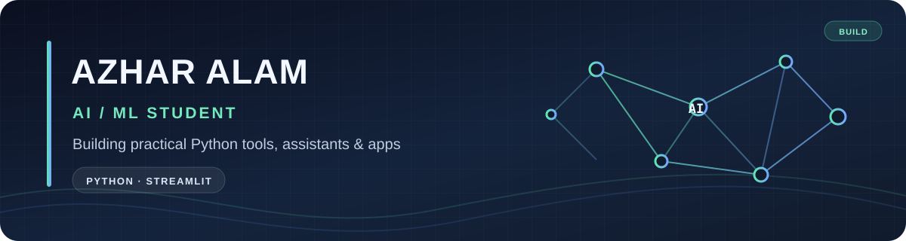

  

# Hi, I'm Azhar Alam 👋

### Python developer & AI/ML student building practical tools, assistants, and interactive apps.

---

## 👨‍💻 About Me

I turn ideas into working Python apps, from small games to assistants that make everyday tasks easier, and I keep improving them as I learn.

- 🐍 Building with **Python**
- 🖥️ Exploring desktop assistants and automation
- 🎓 Interested in useful AI and campus tools
- 🌱 Currently learning **AI/ML**, **JavaScript**, **C/C++**
- 🤝 Open to learning and collaborating on projects

## 🚀 Featured Projects

| Project | What it does | Tech |
| --- | --- | --- |
| [**Aira Desktop Assistant**](https://github.com/azharalam0009/Aira-Assistant-Project) | Windows voice and text assistant with wake-word commands, web and YouTube search, reminders, timers, notes, and optional OpenAI answers. | Python, SpeechRecognition, pyttsx3 |
| [**Campus AI Assistant**](https://github.com/azharalam0009/Campus-AI-Assistant) | College information assistant with chat history and quick questions. | Python, Streamlit |
| [**Clean-Connect**](https://github.com/azharalam0009/Clean-Connect-) | Waste-management prototype focused on practical community needs. | Prototype |

**Smaller projects:** [The Perfect Guess](https://github.com/azharalam0009/The-Perfect-Guess) (number guessing game) · [Snake Water Game](https://github.com/azharalam0009/Snake-water-game) (classic Snake–Water–Gun simulation)

## 🧰 Tech Stack

**Building with**

  
  
  
  
  
  
  
  

**Currently learning**

  
  
  
  
  

## 📊 GitHub Stats

  
  

---

  Thanks for stopping by — feel free to explore my repositories! ✨

